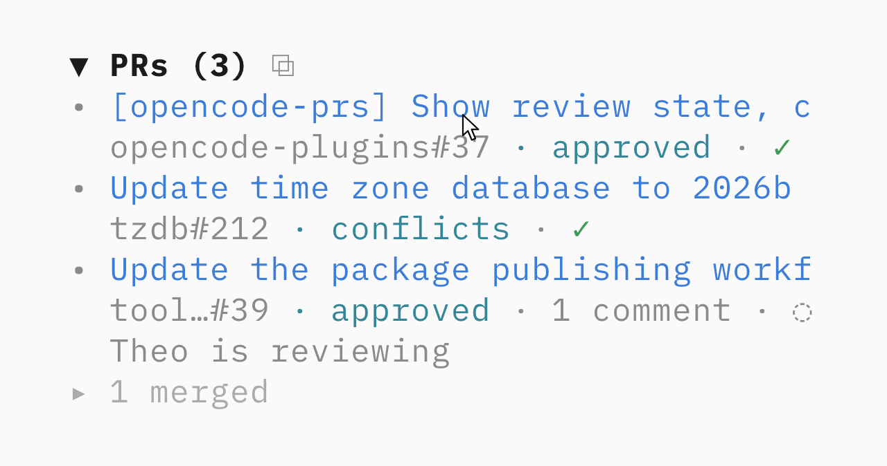
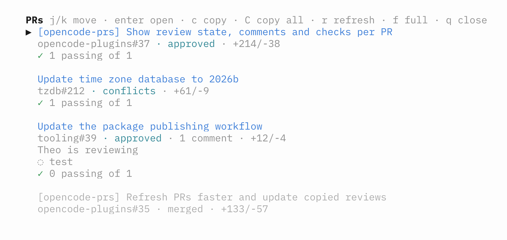

# opencode-prs

[OpenCode](https://opencode.ai) TUI plugin that lists GitHub pull requests opened by the current session.

<picture>
  <source media="(prefers-color-scheme: dark)" srcset="../../assets/prs-hover-dark-v8.gif">
  
</picture>

The sidebar section is collapsible. Each pull request uses a full-width linked title with its muted `repository#number` and status word below: `approved`, `approved · blocked`, or `waiting` for open pull requests, `draft`, or `merged`. A pull request with merge conflicts shows `conflicts` instead, draft or not. The blocked label appears when GitHub reports an approved pull request cannot merge once its checks are done, for example when a required approval is missing. Every status word uses one color, so the words carry the meaning on their own. When the line is too narrow, the repository name shortens first (`tool…#39`), so the number, status, comments and checks stay visible. Open pull requests also show unresolved review comments and a checks indicator: `✓` passing, `×` failing, `◌` pending. Merged pull requests fold into one `▸ 3 merged` line under the open ones; click it to list them in subdued colors, so open work stays prominent. Other tools on your machine can add one muted line under a PR, like `Theo is reviewing` from a review bot (see [Notes from other tools](#notes-from-other-tools)). Hover a clipped title to scroll through its full text once. Click a status line to copy that PR as a Slack-ready summary, or `⧉` in the header to copy the open and draft ones, confirmed with a toast. The count in the header is the open and draft PRs too.

On opencode 2, `/prs` (or clicking the `PRs` header) opens a panel beside the conversation with every PR of the session at full width: title, `repo#number`, status, unresolved comments, diff size, and for open PRs the failing and running checks by name plus a `✓ 397 passing, 56 skipped of 462` line. Keys while the panel has focus: `j`/`k` or arrows move, `enter` or `o` opens the PR in the browser, `c` copies it for Slack, `C` copies the open and draft ones, `r` refreshes, `f` toggles full screen, `q` or `esc` closes. Clicking a row selects it, clicking a title opens it. The `▼` on the sidebar header still folds the section.

<picture>
  <source media="(prefers-color-scheme: dark)" srcset="../../assets/prs-panel-dark-v2.gif">
  
</picture>

## Install

OpenCode 2, in `~/.config/opencode/cli.json`:

```json
{ "plugins": ["opencode-prs"] }
```

OpenCode 1, in `~/.config/opencode/tui.json`:

```json
{ "plugin": ["opencode-prs"] }
```

Then restart OpenCode. The plugin requires an installed and authenticated [GitHub CLI](https://cli.github.com/).

## Slack previews

Copied PRs paste into Slack without a link preview or GitHub card. The Slack link goes through `gh-nopreview.vercel.app`, a stateless redirect to the same path on github.com that gives Slack's link fetcher an empty page. The Markdown and HTML copies link to github.com directly. The redirect is one [`vercel.json`](../../apps/github-nopreview/vercel.json).

## How it works

The plugin finds successful `gh pr create` calls made by the session, plus REST fallbacks that POST to `gh api repos/<owner>/<repo>/pulls`. Pull requests opened by subagents count too, at any depth: every refresh tick lists the session's child sessions, and only re-reads the messages of a session whose update time changed. It fetches every pull request of a session in one GraphQL request through `gh`, and falls back to the REST API per pull request when GraphQL fails, for example when its rate limit is exhausted. Closed pull requests are hidden, while merged pull requests remain visible behind the fold. The sidebar shows up to ten pull requests, ordered by open, draft, then merged, with the newest first in each group; merged ones only take the rows the active ones leave free.

A forked session only lists pull requests created after the fork. Messages copied from the parent keep their original timestamps, so anything older than the fork itself is skipped.

Results are cached by session. Switching tabs shows the previous result immediately and revalidates GitHub data in the background. The active tab refreshes every thirty seconds while checks are running, a PR is less than five minutes old, or GitHub is still computing whether it can merge, and every two minutes otherwise. Unchanged rows are not replaced. A terminal window in the background stops refreshing and catches up as soon as it gets focus again. Merged and closed pull requests are fetched once; `r` in the panel fetches everything again. The panel reads the same cache, so opening it costs no extra request.

Checks are read in two steps to keep GitHub's rate limit cost low. The first query gets each PR with its check suites' status and the rollup's per-state counts, which give the passing and skipped totals. A second query lists failing and running check runs by name, only for suites that are still running or failed. GitHub prices a query by the most rows its connections could return, so listing runs inside every suite of every PR cost 14 points per refresh for seven PRs. The same seven now cost 1 point, plus 1 while checks run or fail. GitHub's merge state also tells us when an approved PR is blocked from merging.

One published package supports OpenCode 1 and OpenCode 2.

## Notes from other tools

A tool that knows something GitHub does not, like a review bot that is reading a PR right now, can show it as one muted line under that PR, in the sidebar and in the panel. Merged PRs show no note, and the Slack copy leaves notes out.

The plugin creates `${XDG_STATE_HOME:-~/.local/state}/opencode-prs/notes/` at startup, so a tool can check that folder exists to know the plugin is installed. Each tool writes its own file there, named `<tool-name>.json`:

```json
{ "updated": 1795006434164, "notes": { "https://github.com/acme/api/pull/7": "Theo is reviewing" } }
```

- `updated` is the time of the tool's last write, in epoch milliseconds. The plugin ignores a file whose `updated` is more than 15 minutes old: its tool stopped, and a stale note would be wrong. Rewrite the file at least every few minutes to keep its notes.
- `notes` maps a PR URL to one line of text. The URL must be exactly `https://github.com/<owner>/<repo>/pull/<number>`. Values that are not strings are ignored.
- The plugin reads the folder when the sidebar opens, every thirty seconds while its session is in view, and when the terminal gets focus back. It reads at most 8 `.json` files, in name order, skips files over 256 KB and ignores files that do not parse.
- Text is cleaned before it shows: control characters and escape sequences are removed, whitespace collapses to single spaces, and the note stops at 80 characters with `…`. The sidebar cuts it again to fit its width.
- When two files have a note for the same PR, they show on one line joined by ` · `, in file name order.
- Write the file atomically (write a temporary file in the same folder, with a name that does not end in `.json`, then rename it), so the plugin never reads half of it.

## Development

```sh
pnpm typecheck
pnpm test
```
