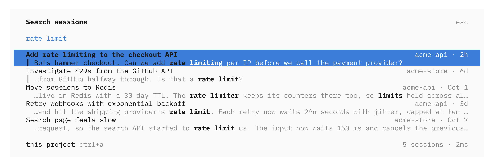
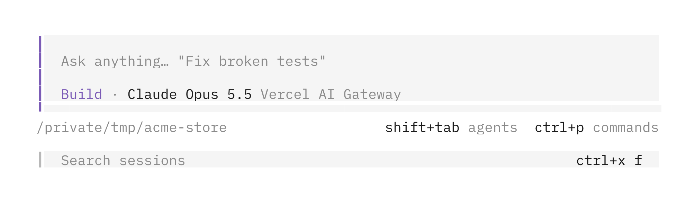

# opencode-search-sessions

Part of [vvo/opencode-plugins](https://github.com/vvo/opencode-plugins).

<picture>
  <source media="(prefers-color-scheme: dark)" srcset="../../assets/search-sessions-dark.png">
  
</picture>

[OpenCode](https://opencode.ai) TUI plugin that searches every prompt and reply of every session, not only their titles. Typos are fine: `serach plugn` finds "search plugin". Each result shows the session title, its project, when it was last active and the part of the message that matched, with your words highlighted. A `┃` before an excerpt marks one of your own prompts, like in the session view. Pick a result with the arrow keys and Enter, or click it, and OpenCode opens that session.

Open it with any of these:

- `ctrl+x f`
- `/search`, or `/search rate limit` to start with a query
- Search sessions in the command palette
- the search field under the home prompt

<picture>
  <source media="(prefers-color-scheme: dark)" srcset="../../assets/search-sessions-home-dark.png">
  
</picture>

In the dialog, `ctrl+a` switches between all projects and the current one. With an empty query it lists your recent sessions.

## Install

OpenCode 2, in `~/.config/opencode/cli.json`:

```json
{ "plugins": ["opencode-search-sessions"] }
```

OpenCode 1, in `~/.config/opencode/tui.json`:

```json
{ "plugin": ["opencode-search-sessions"] }
```

Then restart OpenCode. The first start indexes your history in the background, newest sessions first, and the dialog footer shows the progress. 1,300 sessions take about 20 seconds.

Options go in the object form of the plugin entry:

```json
{ "plugins": [{ "package": "opencode-search-sessions", "options": { "keybind": "ctrl+s", "home": false } }] }
```

- `keybind`: the shortcut, `<leader>f` by default, or `false` for none. `cli.json` keybinds only accept OpenCode's own commands, so plugin shortcuts are set here.
- `home`: `false` hides the field under the home prompt.
- `database`: path to the OpenCode database, when it is not where the OpenCode CLI puts it.
- `index`: path to the search index file.

## How it works

The plugin reads the OpenCode database read-only and keeps its own full-text index with SQLite FTS5, which ships with OpenCode's runtime, so the plugin has no dependencies. Indexing and searching run in a worker thread, so typing never waits for them. On 1,300 sessions (156k messages) the index takes 49 MB and most searches under 20 ms. The slowest, a word found in nearly every message such as "the", take around 40 ms.

- It indexes session titles, your prompts and the text of replies. It skips reasoning, tool calls and subagent sessions. A fork only adds what was written after the fork, so it does not repeat its parent.
- Results where one message holds every word come first, then typo corrections, then sessions where the words are spread over several messages. Within each group BM25 decides, a title match counts extra, and recent sessions get a boost.
- Words of 5 letters or more allow one typo, 9 or more allow two, swapped letters included. Corrections come from the words in your own sessions. A wrong first letter is the one typo it does not fix.
- Quotes search for an exact phrase: `"rate limit"`. The last word matches as a prefix while you type.
- The index catches up when a turn ends, when a session is renamed or deleted, and each time the dialog opens.

The index lives in `~/.cache/opencode-search-sessions/` (or under `$XDG_CACHE_HOME`). Nothing leaves your machine, and deleting the index only means it rebuilds on the next start. The plugin needs the database on the same machine, so it does not search a remote OpenCode server.

One published package supports OpenCode 1 and OpenCode 2.

## Development

```sh
pnpm typecheck
pnpm test
```

Regenerate the screenshots with `pnpm build && python3 scripts/screenshots/search-sessions.py`. They use a fake database, so no real session shows up in them.
